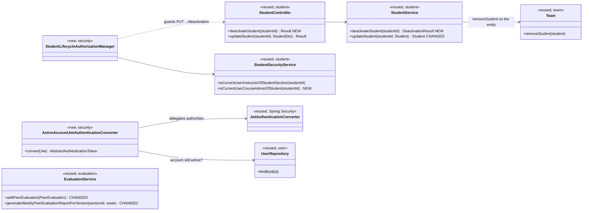
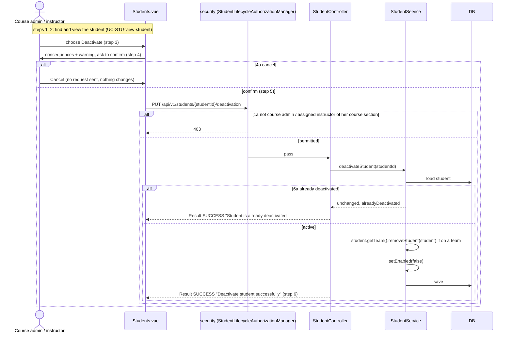
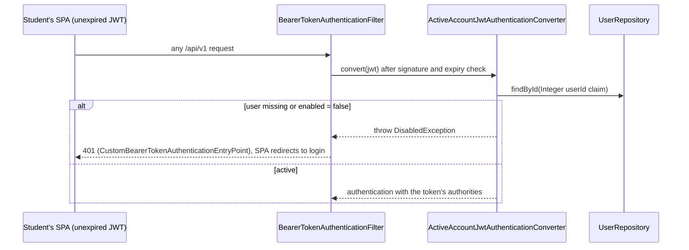
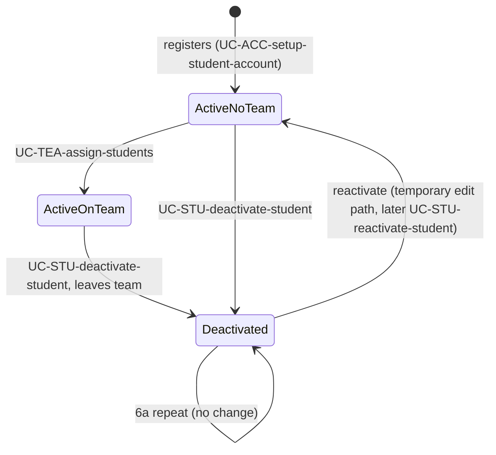

# Student (STU) Design

> Realizes: UC-STU-deactivate-student
> Depends on: FR-SEC-active-account, BR-student-lifecycle, BR-deactivation-team-removal, BR-deactivated-student-evaluations, BR-submission-owed, BR-team-assignment-required, BR-section-scoped-access, BR-role-based-access
> See: [use cases](../requirements/use-cases.md#student), [business rules](../requirements/business-rules.md#course-administration), [SRS security requirements](../requirements/software-requirements-specification.md#security-and-authorization-requirements), [architectural-design.md](architectural-design.md#shared-foundation-components) (foundation component view; authentication runtime view; KD-self-issued-jwt)
> Designed against `main` at `59f0267` (2026-11-04).

## Overview

This area covers the student account lifecycle inside the foundation's `student` package. This design adds a dedicated **deactivation** flow. Before it, the only way to deactivate a student was the generic `PUT /students/{studentId}` edit, which copied `enabled` from the request body whenever the caller held `ROLE_instructor`. That path had no warning or confirmation, so a body that omitted `enabled` deactivated the student silently. Its route rule also admitted the student herself. A deactivated student who was already logged in kept full access until her 2-hour JWT expired.

Deactivation now has its own endpoint. It removes the student from her team (BR-deactivation-team-removal), and each bearer request re-checks that the account is active, so her access ends on her next request (FR-SEC-active-account). That re-check lives in `security`, a platform-tier change recorded in [architectural-design.md](architectural-design.md) (the auth runtime view, Known gaps, and the KD-self-issued-jwt amendment). Two `evaluation` methods change so peer evaluations follow BR-deactivated-student-evaluations.

**Temporary reactivation path.** Until UC-STU-reactivate-student is built, the generic edit keeps a one-way Inactive → Active switch, recorded in that use case's Associated Information. The `updateStudent` and `EditStudentForm.vue` rows below marked *temporary* are removed when that use case is built.

## Components & classes

Backend:
- [`StudentController`](../../backend/src/main/java/team/projectpulse/student/StudentController.java): **new** `deactivateStudent`.
- [`StudentService`](../../backend/src/main/java/team/projectpulse/student/StudentService.java): **new** `deactivateStudent`. **Changed** `updateStudent` (*temporary*): it ignores `enabled=false` and a missing `enabled`, and applies `enabled=true` only from a `ROLE_instructor` caller. Re-enabling never restores a team.
- [`Team.removeStudent`](../../backend/src/main/java/team/projectpulse/team/Team.java): reused as is.
- [`SecurityConfiguration`](../../backend/src/main/java/team/projectpulse/security/SecurityConfiguration.java): **new** route rule `PUT /students/{studentId}/deactivation` → a **new** `security/authorizationmanagers/StudentLifecycleAuthorizationManager`. It grants when [`StudentSecurityService`](../../backend/src/main/java/team/projectpulse/student/StudentSecurityService.java)`.isCurrentUserInstructorOfStudentSection(studentId)` **or** the **new** `isCurrentUserCourseAdminOfStudent(studentId)` is true. The new method compares the caller with `student.getSection().getCourse().getCourseAdmin()` and, like its siblings, fails closed. `.oauth2ResourceServer().jwt()` is wired to the new converter.
- **New** `security/ActiveAccountJwtAuthenticationConverter`: wraps the existing `jwtAuthenticationConverter()` bean and loads the user through [`UserRepository`](../../backend/src/main/java/team/projectpulse/user/UserRepository.java).
- [`EvaluationService`](../../backend/src/main/java/team/projectpulse/evaluation/EvaluationService.java): **changed** `addPeerEvaluation`, `updatePeerEvaluation`, and `generateWeeklyPeerEvaluationReportForSection` (see Key decisions).
- [`SubmissionStatusService.findOwedItems`](../../backend/src/main/java/team/projectpulse/notification/SubmissionStatusService.java): **unchanged**. Its `team != null && isEnabled()` filter already applies BR-submission-owed to a deactivated student.

Frontend:
- [`apis/student`](../../frontend/src/apis/student/index.ts): **new** `deactivateStudent(id)`.
- [`pages/students/Students.vue`](../../frontend/src/pages/students/Students.vue): **new** Deactivate button in the Operations column, shown only for an enabled row. This page is where UC-STU-find-students and UC-STU-view-student already happen, so steps 2–3 stay on one screen.
  - Clicking it opens a warning-type `ElMessageBox.confirm` (buttons Deactivate / Cancel) that lists every consequence in the use case's Associated Information:
    - she can no longer log in or submit weekly activity reports and peer evaluations;
    - her account and submitted work are kept;
    - she is removed from her team;
    - she can be reactivated later;
    - this is not a deletion.
  - On success the SPA shows the server's `message` verbatim in an `ElMessage`, which is how 6a reaches the user, then re-runs the current search.
- [`pages/students/EditStudentForm.vue`](../../frontend/src/pages/students/EditStudentForm.vue) (*temporary*): the Status switch is shown only when the student is inactive, and offers only Inactive → Active.

## Sequence

### UC-STU-deactivate-student: main success scenario and extensions 1a, 4a, 6a

### A deactivated student's next request (FR-SEC-active-account)

### Account lifecycle

## API contract

| Endpoint or job | Caller (who may) | Request | Success | Errors, by extension |
|---|---|---|---|---|
| `PUT /api/v1/students/{studentId}/deactivation` (new) | The course admin of the student's course (whether or not she is assigned to that course section), or an instructor assigned to the student's course section (BR-student-lifecycle) | No body | `Result` SUCCESS, data = the student's `StudentDto` (`enabled=false`, `teamId`/`teamName` null). Message: `Deactivate student successfully`, or `Student is already deactivated` (6a) | 1a → `403`. The student herself, and an id that names no student or is non-numeric → `403` (the route rule refuses first). 4a sends no request |
| `PUT /api/v1/students/{studentId}` (changed, *temporary*) | Unchanged | `enabled=false` or missing is ignored. `enabled=true` from a `ROLE_instructor` caller re-enables a deactivated student; her team is not restored | Unchanged | Unchanged |
| Every bearer-authenticated route (changed) | n/a | n/a | n/a | Deactivated or deleted account → `401` |

## Key decisions

- **A dedicated sub-resource, `PUT /students/{studentId}/deactivation`, not the generic edit.** It gets its own route rule and confirmation flow, and stops the generic edit from deactivating anyone. No audit record is added beyond the existing JPA modified-by stamps; no requirement asks for one. *Rejected:* `PATCH /students/{studentId}` with `{enabled}`, which keeps account status as a field any edit can flip. Reactivation is expected to become `DELETE …/deactivation` when UC-STU-reactivate-student is designed.
- **Authorization by a new `StudentLifecycleAuthorizationManager`: an instructor assigned to the student's course section, or the course admin of her course.** A course admin is *not* automatically one of a course section's instructors. `Course.setCourseAdmin` adds her to the course but not to its course sections, which is why `SectionSecurityService` keeps `isSectionOwner` separate from `isSectionInstructor`. BR-student-lifecycle and BR-section-scoped-access scope a course admin by the course she owns.
  - *Rejected:* reusing `StudentInstructorAuthorizationManager` as is. It would refuse a course admin who isn't assigned to the course section, wrongly firing 1a.
  - *Rejected:* widening that manager. It also guards `GET /evaluations/students/{studentId}/week/{week}/details`, a route outside this use case.
  - *Rejected:* the `UserOwnershipAuthorizationManager` that guards the generic edit, because it also admits the student herself.
- **6a is an idempotent success, not an error.** Two instructors deactivating the same student at once should both see the outcome they wanted. *Rejected:* `409 Conflict`, which would show the second instructor an error for a state she asked for.
- **Remove from team on the entity, inside `StudentService`.** `deactivateStudent` calls `Team.removeStudent` directly. That method already updates both sides: it removes her from `team.students` and sets `student.team` to null. It runs inside `StudentService`'s class-level `@Transactional`, so the flag and the team removal commit together. *Rejected:* calling `TeamService.removeStudentFromTeam`, which follows UC-TEA-remove-student's course-admin-only rule (BR-team-admin-only). BR-team-admin-only now carves out deactivation, and an assigned instructor may deactivate.
- **Per-request account check in the JWT authentication converter.** `ActiveAccountJwtAuthenticationConverter` delegates authorities to the existing converter, then loads the user by the `userId` claim (an `Integer`, as `JwtProvider` writes it) from the shared user table, which covers students and instructors alike. It throws `DisabledException` if the user is missing or disabled. Spring's `JwtAuthenticationProvider` lets that `AuthenticationException` propagate to `BearerTokenAuthenticationFilter`, whose `CustomBearerTokenAuthenticationEntryPoint` answers `401` (not `500`), and the SPA already sends a `401` to login.
  - Login itself is already refused: `MyUserPrincipal.isEnabled()` reads the `enabled` column, so HTTP Basic login of a deactivated account fails with `401` through `CustomBasicAuthenticationEntryPoint`.
  - A stale token sent to a `permitAll()` route also gets `401`. An expired token behaves the same way today, and the SPA's `401` handler clears it, so no new handling is needed. *Rejected:* a revocation blocklist, or a token-version claim bumped on deactivation. Both need the same per-request read plus extra state. *Cost:* one primary-key read per request, accepted at current scale. The check covers instructors as well (UC-INS-deactivate-instructor).
- **The temporary reactivation path only ever turns an account on.** Ignoring `enabled=false` in `updateStudent` also covers a missing `enabled`: `StudentDto.enabled` is a primitive `boolean`, so an omitted value deserializes to `false`. *Rejected:* removing the status switch now, which would leave no reactivation path before UC-STU-reactivate-student is built. The path keeps the generic edit's existing route rule. Only an instructor assigned to her course section passes it, so a course admin who isn't assigned can't use this interim path. That is narrower than BR-student-lifecycle, never wider, and is accepted for the interim.
- **`addPeerEvaluation` rejects a deactivated evaluatee explicitly.** It checks `evaluatee.isEnabled()` before the same-team check and throws `PeerEvaluationIllegalArgumentException` with a message that says the teammate is deactivated. The same-team check would already reject her once her team is null, but its "must be on the same team" message misleads, and it misses a legacy deactivated row that still has a team. *Rejected:* relying on team removal alone. `updatePeerEvaluation`, the separate path for re-submitting an existing evaluation (BR-evaluation-editable-until-close), applies the same check to the stored evaluation's evaluatee. Otherwise a teammate could still change an evaluation of a deactivated student.
- **The section peer evaluation report keeps a deactivated student only for the weeks she was evaluated.** `generateWeeklyPeerEvaluationReportForSection` currently lists students whose `team` is not null. Team removal would therefore erase a deactivated student from every past week, losing retained work. The new candidate set is: students on a team whose account is active, plus any student of the course section who received at least one peer evaluation for that week (BR-deactivated-student-evaluations).
  - Her own self-evaluation counts: BR-submission-owed treats a student as a member of her own team.
  - Her row's `teamName` is null (`getPeerEvaluationAverage` already null-guards the team), and the SPA shows it blank. *Rejected:* keeping her on her team after deactivation, which would contradict BR-deactivation-team-removal and keep her in her teammates' BR-submission-owed set.

## Data model

No schema change. Deactivation uses the existing `enabled` column on the user table (`PeerEvaluationUser`) and the already-nullable `Student.team`. Shared model: the SRS's Business Domain Model.

## Reuse & cross-cutting

- **Auth:** follows the route-rule plus `AuthorizationManager` pattern. The new `StudentLifecycleAuthorizationManager` delegates to `StudentSecurityService`, reusing `isCurrentUserInstructorOfStudentSection` and adding `isCurrentUserCourseAdminOfStudent`. The new converter extends the platform authentication path; see [architectural-design.md](architectural-design.md) (KD-self-issued-jwt amendment).
- **Submission status:** `notification`'s `SubmissionStatusService` is the single implementation of BR-submission-owed and already excludes a student who is off a team or inactive. Nothing in it changes.
- **Email:** none. UC-STU-deactivate-student notifies only the actor, in the UI.

## Tests

| Use case, flow | Level (unit / integration) | Asserts |
|---|---|---|
| UC-STU-deactivate-student, main success | unit (`StudentServiceTest`) | Student ends `enabled=false` with team null, the former team's students no longer include her, and she is saved |
| UC-STU-deactivate-student, main success | integration (`StudentIntegrationTest`) | Admin token → `SUCCESS`, and the DTO shows `enabled=false` and no team. A re-fetch agrees. Her HTTP Basic login is refused |
| UC-STU-deactivate-student, 1a | integration | Her own student token → `403`. A token for an instructor not assigned to her course section (seed `instructor3`, assigned only to `section3`) → `403`. Afterwards she is still enabled and on her team |
| UC-STU-deactivate-student, course admin not assigned to the course section | unit (`StudentSecurityService` / manager) | The course admin of her course is granted even when absent from `section.instructors`. An instructor of another course is not |
| UC-STU-deactivate-student, 4a | none (no request is sent) | The cancel is a client-side dialog choice. There is no backend behavior to assert, and the repo has no frontend test harness |
| UC-STU-deactivate-student, 6a | unit + integration | A second deactivation → `SUCCESS` with the "already deactivated" message. Unit: `save` is never called |
| FR-SEC-active-account, logged-in student | integration | A token obtained before deactivation → `401` on its next request |
| Temporary reactivation | integration | `PUT /students/{studentId}` with `enabled=true` on a deactivated student (instructor token) → enabled, still no team |
| Generic edit, `enabled=false` | integration | `PUT /students/{studentId}` with `enabled=false` on an active student → still enabled |
| Generic edit, `enabled` missing | integration | `PUT /students/{studentId}` with `enabled` omitted → status unchanged |
| BR-deactivated-student-evaluations, submit | unit (`EvaluationServiceTest`) | `addPeerEvaluation` with a deactivated evaluatee throws `PeerEvaluationIllegalArgumentException` with the deactivated-teammate message |
| BR-deactivated-student-evaluations, re-submit | unit (`EvaluationServiceTest`) | `updatePeerEvaluation` of an evaluation whose evaluatee is now deactivated throws the same exception and saves nothing |
| BR-deactivated-student-evaluations, report | unit (`EvaluationServiceTest`) | For week W the report includes a deactivated, teamless student who received an evaluation for W, and excludes her for a week with none |

## Open questions / risks

- The per-request account check adds one indexed read to every API call. It is acceptable at the current single-instance scale, but it is the first per-request DB dependency in authentication (KD-self-issued-jwt amendment).
- Test fixtures: integration tests deactivate seeded students and rely on `AbstractIntegrationTest`'s `@Transactional` rollback, so no `@DirtiesContext` and no new seed rows are needed.
- Legacy rows: a student deactivated through the old generic edit may still have a team. `findOwedItems` and the new `addPeerEvaluation` check both handle her. `/implement` does not migrate such rows.
